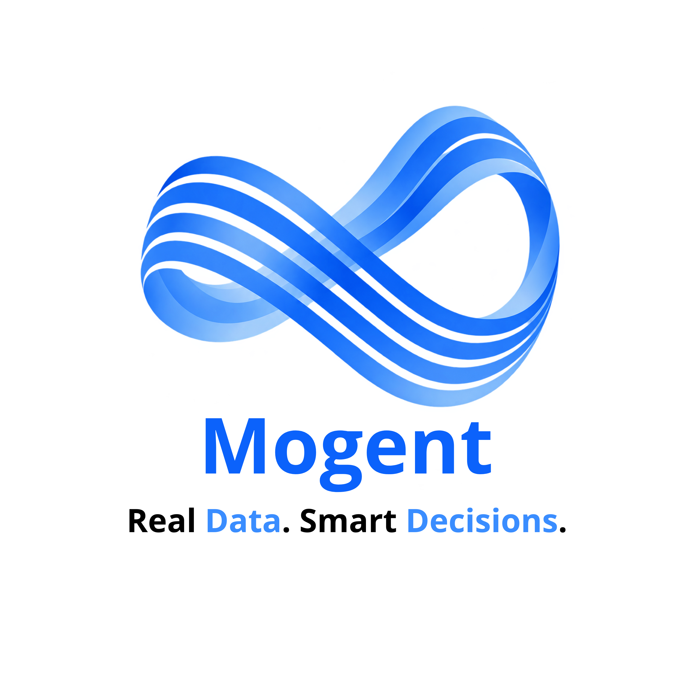
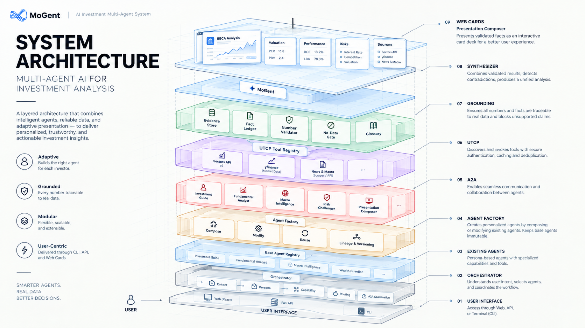

# ✦ MoGent

### AI Investment Multi-Agent System for Indonesian Stocks

> **Understand. Adapt. Analyze. Verify. Present.**

MoGent is an AI investment multi-agent system designed to adapt
financial analysis to **different investor personas**, rather than
forcing every user into one fixed workflow.

Its core differentiator is the **Agent Factory**: when an existing agent
does not fully match a user's needs, MoGent can compose or modify
existing capabilities into a **new derived agent** while keeping the
original agents untouched.

MoGent also applies a **grounded-analysis pipeline** where financial
facts come from tools, are stored as evidence, validated, and only then
used by the LLM to produce natural-language analysis.

------------------------------------------------------------------------

## 🚀 Why MoGent?

Most AI investment assistants follow a simple pattern:

``` text
User → LLM → Data → Answer
```

MoGent takes a different approach:

``` text
User Need
    ↓
Understand
    ↓
Adapt
    ↓
Analyze
    ↓
Verify
    ↓
Present
```

The system is built around two principles:

-   **Personalization** --- the right agent for the right investor.
-   **Trust** --- no evidence, no claim.

------------------------------------------------------------------------

## 🧠 What Makes MoGent Different?

### 1. Agent Factory

MoGent does not force every investor into a predefined persona.

It can dynamically:

-   **COMPOSE** existing agents
-   **MODIFY** existing capabilities
-   **REUSE** compatible derived agents
-   Preserve **lineage and versioning**
-   Keep all base agents **immutable**

Example:

``` text
Beginner Investor
        +
Wealth Guardian
        ↓
   Agent Factory
        ↓
Personalized Derived Agent
```

The original agents remain unchanged.

------------------------------------------------------------------------

### 2. Grounding & Anti-Hallucination

Financial analysis requires more than fluent language.

MoGent separates **facts** from **language generation**:

``` text
External Tools
      ↓
Evidence Store
      ↓
Fact Ledger
      ↓
Number Validator
      ↓
Synthesizer
      ↓
Grounded Answer
```

Key rule:

> **No data, no claim.**

The LLM does not freely invent financial numbers. Facts are referenced
through evidence IDs and validated before reaching the final response.

------------------------------------------------------------------------

### 3. Multi-Agent Collaboration

MoGent uses **A2A (Agent-to-Agent)** communication so specialized agents
can collaborate on a request.

The system combines:

-   Persona agents
-   Specialist agents
-   Orchestrator
-   Agent Factory
-   Grounding components
-   Synthesizer
-   Presentation Composer

------------------------------------------------------------------------

### 4. Presentation Composer

MoGent does not simply dump raw analysis into a webpage.

A dedicated **Presentation Composer** converts validated facts into
structured, interactive cards.

``` text
Validated Facts
      ↓
Presentation Composer
      ↓
┌──────────┐ ┌──────────┐ ┌──────────┐
│ Summary  │ │ Valuation│ │Performance│
└──────────┘ └──────────┘ └──────────┘
      ↓
┌──────────┐ ┌──────────┐ ┌──────────┐
│   Risk   │ │ News/Macro│ │ Sources │
└──────────┘ └──────────┘ └──────────┘
```

The Presentation Composer:

-   does **not** perform new financial analysis
-   does **not** invent numbers
-   adapts presentation to the user's needs
-   keeps sources and limitations visible

------------------------------------------------------------------------

# 🏗️ Architecture




# 🤖 Agent System

MoGent currently uses **9 base agents**:

### Persona Agents

  Agent                   Purpose
  ----------------------- ----------------------------------------------
  `investment_guide`      Complete beginner / educational explanations
  `fundamental_analyst`   Fundamental investment analysis
  `macro_intelligence`    Macroeconomic perspective
  `wealth_guardian`       Wealth preservation and long-term stability

### Specialist Agents

  Agent                 Purpose
  --------------------- ------------------------------------------------
  `risk_challenger`     Challenges assumptions and identifies risks
  `valuation_analyst`   Valuation and relative-value analysis
  `catalyst_analyst`    Identifies potential business/market catalysts
  `news_sentiment`      News and sentiment analysis

### Presentation

  ---------------------------------------------------------------------
  Agent                              Purpose
  ---------------------------------- ----------------------------------
  `presentation_composer`            Converts validated analysis into
                                     presentation cards

  ---------------------------------------------------------------------

Base agents are treated as **immutable assets**. Derived agents are
stored separately with lineage and version information.

------------------------------------------------------------------------

# 🔄 Example: Personalized Agent Creation

User:

``` text
"I'm a beginner, but I want to know whether BBCA
is suitable for wealth preservation."
```

MoGent:

``` text
User Request
     ↓
Intent + Persona Detection
     ↓
Beginner + Wealth Preservation
     ↓
Agent Factory
     ↓
Compose existing capabilities
     ↓
Derived Agent
     ↓
BBCA Analysis
     ↓
Grounding
     ↓
Personalized Answer
```

Instead of selecting only one persona, MoGent can create a derived agent
that combines the relevant capabilities.

------------------------------------------------------------------------

# 🛡️ Grounding Pipeline

Every important financial number follows a controlled path:

``` text
Tool Response
     ↓
Evidence
     ↓
Fact Extraction
     ↓
Fact Ledger
     ↓
Identity Lock
     ↓
Sanity Check
     ↓
Number Validator
     ↓
Synthesizer
```

### Core rules

**Facts from tools, language from LLM.**

The LLM generates explanations, while validated data is rendered from
the fact layer.

**No data = no claim.**

If reliable evidence is unavailable, MoGent explicitly reports the
limitation instead of fabricating a value.

**Agent integrity.**

Base agents are read-only. Derived agents are append-only and retain
lineage.

------------------------------------------------------------------------

# 🔌 Data & Tooling

MoGent uses **UTCP** as the tool-access layer.

Current data sources include:

-   **Sectors Financial API v2**
    -   Company profile
    -   Valuation
    -   Financials
    -   Dividend
    -   Ownership
    -   Peers
    -   News
    -   Corporate actions
    -   IDX/index data
    -   Screener
-   **Yahoo Finance / yfinance**
    -   Quarterly financial statements
    -   Major holders
    -   Institutional holders
    -   Market data
-   Macro and news sources used by the macro/news tooling

For IDX tickers, Yahoo Finance uses the `.JK` suffix.

All retrieved financial facts are still passed through the grounding
layer.

------------------------------------------------------------------------

# 🖥️ Interfaces

MoGent supports three primary interfaces:

### React Web

Interactive **Web Card Interface** for presenting analysis.

### FastAPI

REST API for integrating the MoGent backend with frontend applications.

### CLI

Terminal interface for development, debugging, and demonstration.

------------------------------------------------------------------------

# 📡 API

Start the backend:

``` bash
uvicorn backend.api:app --reload --port 8000
```

Main endpoints:

  Method   Endpoint                 Purpose
  -------- ------------------------ ------------------------------
  `GET`    `/health`                Service and runtime status
  `GET`    `/config`                Public configuration
  `POST`   `/query`                 Main analysis endpoint
  `GET`    `/agents`                List base and derived agents
  `GET`    `/agents/{id}`           Agent specification
  `GET`    `/agents/{id}/lineage`   Agent lineage
  `GET`    `/tools`                 UTCP tool registry

Example:

``` bash
curl -X POST http://localhost:8000/query \
  -H "Content-Type: application/json" \
  -d '{"query":"Bagaimana fundamental BBCA?"}'
```

------------------------------------------------------------------------

# 💻 Installation

MoGent terdiri dari **LLM lokal melalui Ollama**, backend
Python/FastAPI, dan frontend React/Vite.

Sebelum menjalankan project, pastikan **Ollama di-install secara
terpisah** dan kedua model yang digunakan MoGent sudah tersedia.

------------------------------------------------------------------------

## 1. Install Ollama

Install **Ollama** terlebih dahulu pada komputer Anda.

Setelah instalasi selesai, pastikan command berikut tersedia:

``` bash
ollama --version
```

Jalankan Ollama:

``` bash
ollama serve
```

Default Ollama URL:

``` text
http://localhost:11434
```

> Ollama harus tetap berjalan ketika MoGent digunakan karena LLM
> dijalankan secara lokal.

------------------------------------------------------------------------

## 2. Install Model LLM

MoGent menggunakan dua model:

``` text
deepseek-r1:7b
qwen2.5:7b
```

Download model dengan:

``` bash
ollama pull deepseek-r1:7b
ollama pull qwen2.5:7b
```

Verifikasi:

``` bash
ollama list
```

Pastikan kedua model muncul pada daftar model Ollama.

------------------------------------------------------------------------

## 3. Setup Environment Variables

Buat file `.env` pada **root directory MoGent**:

``` env
MODEL_NAME=deepseek-r1:7b
OLLAMA_BASE_URL=http://localhost:11434
MODEL_NAME_2=qwen2.5:7b
SECTORS_API_KEY=your_sectors_api_key_here
```

### Environment Variables

  Variable            Value                      Fungsi
  ------------------- -------------------------- -------------------------------
  `MODEL_NAME`        `deepseek-r1:7b`           Model LLM utama
  `OLLAMA_BASE_URL`   `http://localhost:11434`   Endpoint Ollama lokal
  `MODEL_NAME_2`      `qwen2.5:7b`               Model LLM kedua
  `SECTORS_API_KEY`   `...`                      API key Sectors Financial API

**Jangan commit `.env` ke repository.**

Pastikan `.env` sudah masuk `.gitignore`.

------------------------------------------------------------------------

## 4. Setup Backend

Pastikan Python 3.11+ sudah terinstall:

``` bash
python3 --version
```

Buat virtual environment:

``` bash
python3 -m venv .venv
```

Aktifkan:

### Linux / macOS

``` bash
source .venv/bin/activate
```

### Windows

``` powershell
.venv\Scripts\activate
```

Install dependency:

``` bash
pip install -r requirements.txt
```

------------------------------------------------------------------------

## 5. Setup Frontend

Masuk ke directory frontend:

``` bash
cd frontend
```

Install dependency Node.js:

``` bash
npm install
```

Setelah selesai, kembali ke root project jika diperlukan:

``` bash
cd ..
```

------------------------------------------------------------------------

# ▶️ How to Run

MoGent membutuhkan **Ollama + Backend + Frontend**.

Disarankan menggunakan **3 terminal**.

------------------------------------------------------------------------

## Terminal 1 --- Ollama

Jalankan:

``` bash
ollama serve
```

Ollama harus tersedia pada:

``` text
http://localhost:11434
```

------------------------------------------------------------------------

## Terminal 2 --- Backend

Dari root project MoGent, aktifkan virtual environment:

``` bash
source .venv/bin/activate
```

Kemudian jalankan backend:

``` bash
uvicorn backend.api:app --port 8000
```

Backend tersedia pada:

``` text
http://localhost:8000
```

Untuk development dengan auto-reload:

``` bash
uvicorn backend.api:app --reload --port 8000
```

### Backend API Documentation

FastAPI menyediakan Swagger UI:

``` text
http://localhost:8000/docs
```

Health check:

``` bash
curl http://localhost:8000/health
```

------------------------------------------------------------------------

## Terminal 3 --- Frontend

Masuk ke folder frontend:

``` bash
cd frontend
```

Jalankan development server:

``` bash
npm run dev
```

Vite akan menampilkan URL frontend pada terminal, biasanya:

``` text
http://localhost:5173
```

Buka URL tersebut pada browser.

------------------------------------------------------------------------

# ⚡ Quick Start

Jika semua dependency sudah terinstall:

### Terminal 1

``` bash
ollama serve
```

### Terminal 2

``` bash
source .venv/bin/activate
uvicorn backend.api:app --port 8000
```

### Terminal 3

``` bash
cd frontend
npm run dev
```

Kemudian:

``` text
Browser
   │
   ▼
React / Vite
   │
   ▼
FastAPI :8000
   │
   ▼
MoGent Orchestrator
   │
   ├── Agent Factory
   ├── A2A
   ├── UTCP
   ├── Grounding
   └── Synthesizer
   │
   ▼
Ollama :11434
   │
   ├── deepseek-r1:7b
   └── qwen2.5:7b
```

# 🧪 CLI

Run:

``` bash
python main.py
```

Debug mode:

``` bash
python main.py --debug
```

Useful commands:

``` text
/agents
/agents show <id>
/agents lineage <id>
exit
```

------------------------------------------------------------------------

# ✅ Verification

Run the deterministic test suite:

``` bash
python tests_fast.py
```

The project verification covers core areas such as:

-   Agent Factory
-   Agent validation
-   Grounding
-   API behavior
-   yfinance integration
-   Agent lineage
-   Data integrity

The latest project verification reached **70/70 passed** across the
documented verification suite.

------------------------------------------------------------------------

# 📁 Project Structure

``` text
MoGent/
├── main.py
├── .env
├── requirements.txt
│
├── backend/
│   ├── api.py
│   ├── orchestrator/
│   │   ├── orchestrator.py
│   │   ├── intent_detector.py
│   │   ├── agent_router.py
│   │   ├── agent_composer.py
│   │   └── synthesizer.py
│   │
│   ├── agents/
│   ├── specialists/
│   ├── agent_factory/
│   ├── a2a/
│   ├── utcp/
│   ├── grounding/
│   ├── runtime/
│   ├── llm/
│   ├── presentation/
│   └── sector_templates/
│
├── data/
│   └── agents/
│       ├── base/
│       ├── derived/
│       └── registry.json
│
└── frontend/
    └── React Web Card Interface
```

------------------------------------------------------------------------

# 🔐 Security & Integrity

Secrets are kept outside the source code:

``` text
.env
```

Base agents are protected using integrity hashes.

The Agent Factory does not overwrite base agents. New derived agents are
registered separately with:

-   parent agents
-   operation type
-   version
-   lineage
-   fingerprint/checksum

This makes the agent-generation process traceable and auditable.

------------------------------------------------------------------------

# ⚠️ Data Availability

Some Sectors API endpoints depend on the current API tier.

When Sectors endpoints are unavailable, MoGent can use `yfinance` for
supported IDX data such as quarterly financial statements and
shareholder information.

These fallback values do **not** bypass grounding:

``` text
Yahoo Finance
     ↓
Evidence ID
     ↓
Sanity Check
     ↓
Number Validator
     ↓
Final Answer
```

The system is intentionally designed to expose data limitations rather
than hide them.

------------------------------------------------------------------------

# 🎯 Project Philosophy

MoGent is not designed to be an autonomous trading bot.

It is an **AI investment analysis system** focused on:

> **Personalization + Grounding + Multi-Agent Collaboration**

The goal is simple:

``` text
Don't build one AI for every investor.

Build the right agent
for the person asking.
```

------------------------------------------------------------------------

# 🏆 MoGent

**Understand. Adapt. Analyze. Verify. Present.**

MoGent builds the right agent for each investor, verifies the facts
behind the analysis, and presents the result in a form that matches the
person who asked.